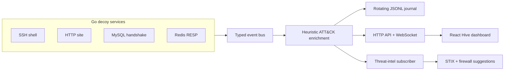

# Hive — Interactive Honeypot Network

**Hive is a security engineering portfolio project that turns activity against decoy services into searchable, live telemetry.** Four Go sensors (SSH, HTTP, MySQL, and Redis) feed a React and TypeScript operator dashboard. Website interactions, protocol probes, and simulated SSH commands become structured events that can be reviewed as they happen.

It demonstrates end-to-end work across network protocol handling, concurrent event delivery, input sanitization, journaled storage, API and WebSocket design, containerized deployment, and an operator-focused interface.

**Stack:** Go · React · TypeScript · WebSockets · TCP/IP · JSONL · Docker Compose

> **Run Hive as a sensor, not as infrastructure.** Its SSH, web, MySQL, and Redis services are decoys, not production servers. Keep the dashboard API private. For any network exposure, use a dedicated, isolated host that contains no production credentials or sensitive data. The fake SSH shell never runs commands on the host, and suggested firewall rules are never applied automatically.

## See it in action

### Decoy website

The inversehacker site is served by the HTTP sensor. Its responsive navigation works on mobile, link clicks are captured without reloading the page, and the inquiry form returns a simulated confirmation while recording only which fields were submitted.

<p align="center">
  
</p>

### Operator dashboard

The dashboard streams sensor events, searches retained journal history, surfaces delivery and storage health, and opens each event in a detailed view. The embedded site preview keeps decoy interactions connected to the same live feed.

<p align="center">
  
</p>
<p align="center">
  
</p>

### Try the workflow

Run Hive locally, then open the dashboard and try the short walkthrough:

1. Visit **[http://127.0.0.1:5173](http://127.0.0.1:5173)** and select **Decoy website** in the sidebar.
2. Use the `inversehacker` navigation or call-to-action links. They scroll smoothly without reloading and publish HTTP **link click** events with the destination.
3. Submit the inquiry form at the bottom of the decoy page. It shows a simulated confirmation and publishes a **form submit** event; submitted field values are not retained.
4. In a second terminal, connect to the SSH decoy and try a few commands:

   ```sh
   ssh -p 2222 root@127.0.0.1
   ```

   Accept the host key on first connection, enter any password, then try `whoami`, `ps`, or `cd /var/www/html`. Those commands are recorded and answered by the simulated shell; they are never executed on your computer.

You can generate a web scan without any additional tools:

```sh
curl http://127.0.0.1:8080/wp-login.php
```

For more sample activity, if you have these client tools installed:

```sh
redis-cli -h 127.0.0.1 -p 6379 PING
mysql --protocol=TCP -h 127.0.0.1 -P 3306 -u demo
```

Hive’s dashboard is at **127.0.0.1:5173**, its inversehacker decoy site is at **127.0.0.1:8080**, and the local health endpoint is **127.0.0.1:8000/api/health**.

## Engineering highlights

- **Protocol and service design:** separate SSH, HTTP, MySQL handshake, and Redis RESP sensors normalize different wire interactions into a shared event model.
- **Concurrency and delivery:** a typed event bus enriches, journals, retains, and fans out events through bounded subscriber queues so slow clients do not stall sensor handlers.
- **Full-stack event flow:** the React dashboard merges historical search results with a reconnecting WebSocket stream; event selection opens a keyboard-accessible detail panel.
- **Safe deception:** SSH input is answered by a fake shell with no host command execution. Credential redaction, request bounds, private-by-default binds, and manual-only firewall suggestions constrain the lab.
- **Operational readiness:** rotating JSONL history, retention controls, health metrics, bearer-token API protection for non-loopback binds, and a hardened local Compose profile support repeatable operation.
- **Threat-intelligence workflow:** normalized source IPs can be exported as STIX 2.1 indicators and reviewed firewall suggestions.
- **Testable behavior:** Go tests cover journal search and retention, API token checks, and representative HTTP, SSH, MySQL, and Redis parsing or interaction paths.

## Quick start

### Requirements

- Go 1.26.4 or later
- Node.js 20.19+ or 22.12+, with npm

### Launch

From the repository root:

```sh
./run-local.sh
```

The launcher installs dashboard dependencies if needed and starts the backend and Vite development server. Keep the terminal open while using Hive. Press **Ctrl+C** to stop. By default, all five listeners bind to `127.0.0.1`, keeping the decoys and dashboard on this computer.

If startup reports **address already in use**, another process is using one of Hive’s ports. Close that process or configure a different port using the environment variables below.

## Architecture



### Event flow

1. A sensor observes an interaction and publishes a typed event with source address, service, event type, timestamp, and sanitized payload.
2. The event bus assigns an ID and sensor ID, applies heuristic MITRE ATT&CK tags, retains a recent in-memory window, appends to the JSONL journal, and fans out to bounded subscriber queues.
3. The dashboard searches retained journal events through the API, receives new events over WebSocket, and reconnects with backoff if the connection drops.
4. The threat-intelligence subscriber deduplicates valid IP addresses and writes suggested firewall rules and STIX indicators for an operator to inspect.

## Components and boundaries

| Component | Captures | Important limit |
|---|---|---|
| SSH decoy | Login usernames and commands from shell or SSH `exec` requests | Fake shell; no commands run. Passwords are discarded. A persistent Ed25519 host key is stored at `data/ssh_host_ed25519`. |
| HTTP decoy | Method, path, user agent, bounded request body, inversehacker link clicks, and inquiry form submissions | Inquiry form values are discarded; other captured request bodies may still contain sensitive input. Redaction is best effort. |
| MySQL decoy | Login username from a bounded handshake packet | Returns access denied; does not store the password response or implement SQL sessions. |
| Redis decoy | Commands from inline and RESP requests | Minimal replies for common commands; not a Redis-compatible database. `AUTH` values and common secret assignments are redacted. |
| Dashboard/API | Searchable retained events, WebSocket stream, and sensor delivery metrics | API and WebSocket require a bearer token when bound beyond loopback. Dashboard keeps up to 500 events in browser memory. |
| Threat intelligence | Valid source IPs and service names | ATT&CK tags are heuristics; IP indicators are investigative leads, not proof of malicious activity. |

Captured telemetry may still contain sensitive attacker-supplied data. Review retention, access, and legal requirements before collecting data beyond a local lab.

## Configuration

Set environment variables before launching the backend. The local defaults keep every listener on loopback.

| Variable | Default | Purpose |
|---|---|---|
| `HIVE_SSH_PORT` | `2222` | SSH decoy port |
| `HIVE_HTTP_PORT` | `8080` | HTTP decoy port |
| `HIVE_MYSQL_PORT` | `3306` | MySQL decoy port |
| `HIVE_REDIS_PORT` | `6379` | Redis decoy port |
| `HIVE_API_PORT` | `8000` | API port when `HIVE_API_ADDR` is unset |
| `HIVE_SENSOR_ID` | `hive-01` | Sensor identifier attached to events |
| `HIVE_EVENT_LOG` | `data/events.jsonl` | Append-only JSONL journal; active file plus one 64 MiB backup |
| `HIVE_SSH_ADDR` | `127.0.0.1:<port>` | SSH bind address |
| `HIVE_HTTP_ADDR` | `127.0.0.1:<port>` | HTTP bind address |
| `HIVE_MYSQL_ADDR` | `127.0.0.1:<port>` | MySQL bind address |
| `HIVE_REDIS_ADDR` | `127.0.0.1:<port>` | Redis bind address |
| `HIVE_API_ADDR` | `127.0.0.1:<port>` | API bind address |
| `HIVE_ALLOWED_ORIGINS` | Local Vite origins | Comma-separated browser origins allowed by CORS and WebSocket checks |
| `HIVE_API_TOKEN` | unset | Optional bearer token for API and WebSocket. Required whenever `HIVE_API_ADDR` binds to a non-loopback address. The dashboard prompts for it and keeps it in the current browser session. |
| `HIVE_RETENTION_DAYS` | unset | Delete journal records older than this many days at startup; rotated and active JSONL files are both pruned. |
| `VITE_WS_URL` | Derived from dashboard host | Optional WebSocket URL for a remote dashboard |
| `VITE_HIVE_SITE_URL` | `http(s)://<dashboard-host>:8080/` | Optional URL used by the dashboard’s decoy-site preview |

To deliberately expose a decoy on a sensor host, set only the needed `HIVE_*_ADDR` to a specific interface address or `0.0.0.0:<port>`, then configure the host firewall. When binding the API beyond loopback, configure `HIVE_API_TOKEN`; for a remote dashboard, keep access on a trusted private network and use an authenticated proxy.

## API

| Endpoint | Description |
|---|---|
| `GET /api/health` | Process health and sensor ID |
| `GET /api/events?limit=100` | Recent in-memory events, newest first; maximum 500 |
| `GET /api/search?q=...&service=ssh&limit=100&offset=0` | Search the active and rotated JSONL journal, newest first; maximum page size 500 |
| `GET /api/metrics` | Subscriber count, dropped deliveries, and journal errors |
| `GET /ws/events` | Live event stream |
| `POST /__hive/click` | Record a same-site link destination from the decoy website |
| `POST /__hive/contact` | Return a simulated form confirmation and record field names; submitted values are discarded |

The journal is local JSONL rather than an indexed database. It rotates at 64 MiB and keeps one backup. Search scans those bounded journal files; large captures will benefit from a future indexed database. The dashboard searches the journal and exports the current filtered results to CSV. A browser can miss live events if its subscriber queue fills; dropped deliveries and journal write errors appear in the dashboard and `/api/metrics`.

### Container profile

Set a token and start the isolated local profile:

```sh
export HIVE_API_TOKEN="$(openssl rand -hex 32)"
docker compose up --build
```

The dashboard is at `http://127.0.0.1:5173`; enter the configured token when prompted. All published ports bind to loopback by default, telemetry persists in the `hive-data` volume, containers drop Linux capabilities, and the backend runs read-only except for its data volume. The dashboard does not embed the token in its static build. Change the token by restarting the backend and signing in again. Set `HIVE_RETENTION_DAYS` to control journal retention (30 days by default in Compose).

For the container profile, `docker compose down -v` removes the persistent volume, including the event journal, SSH host key, blocklist, and STIX output. For a local run, remove the specific files listed under [Generated data](#generated-data) when you want to clear them.

## Generated data

- `data/events.jsonl` and its rotated backup contain recent event history.
- `data/ssh_host_ed25519` stores the SSH decoy’s private host key with restricted file permissions. Keep it with the sensor’s data when moving the same sensor; deleting it causes clients to see a new SSH host fingerprint.
- `iptables-blocklist.txt` contains suggested firewall commands. Inspect and adapt entries manually; never pipe this file directly to a shell.
- `threat-intel.stix.json` contains generated STIX 2.1 indicator objects.

The journal and intelligence files are relative to the backend’s working directory unless `HIVE_EVENT_LOG` is an absolute path. The local launcher runs the backend from the repository root.

## Development

Backend:

```sh
go build ./cmd/hive
go test ./...
```

Frontend:

```sh
cd frontend
npm run build
npm run lint
```

## Scope and next steps

Hive is a development-stage security lab, not a turnkey production SOC platform. The event journal is bounded rotating JSONL rather than an indexed database, ATT&CK mappings are heuristic, GeoIP enrichment is not included, and protocol implementations are intentionally limited to decoy behavior. Firewall output is advisory and is never applied automatically. Natural next steps include an indexed store for larger captures, richer sensor enrollment and administration, and configurable threat-intelligence enrichment.

## License

Hive is released under the [MIT License](LICENSE).
